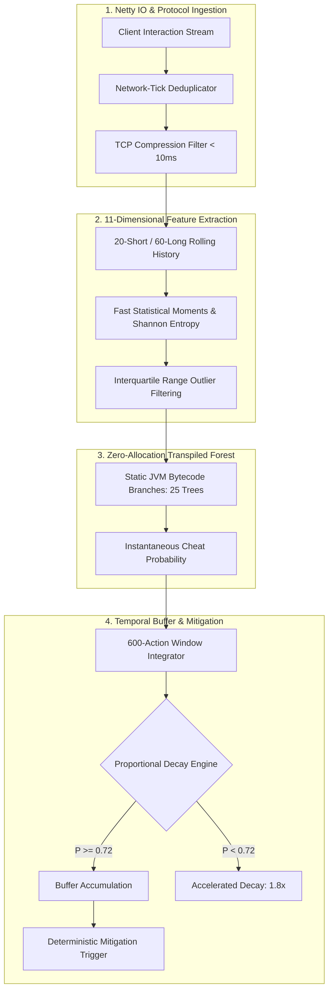

# Real-Time Behavioral Kinematics & Statistical Telemetry Runtime
### Zero-Dependency Decision Forest & Heuristic Anomaly Detection Pipeline
**Discipline:** High-Performance Game Security, Distributed Telemetry Ingestion, Applied MLOps  
**Target Architecture:** Java Virtual Machine (JVM 8+) / Netty Asynchronous IO / Python (Scikit-Learn Pipeline)

---

> [!NOTE]
> **Production Status & Intellectual Property Notice:**  
> This repository is an **architectural case study and algorithmic specification** derived from an active, high-tickrate game server anticheat runtime (protecting 200+ concurrent players per node across thousands of daily competitive engagements). In accordance with game security best practices, live detection weights, proprietary heuristic tripwires, and internal network payloads are strictly omitted to prevent adversarial counter-adaptation.
## Executive Summary

Client-side game security (kernel drivers, intrusive OS hooks) faces severe operational resistance: platform instability, hypervisor-level bypasses (DMA), and user privacy concerns. Conversely, server-side detection often degrades simulation performance when introducing heavy external machine learning runtimes (ONNX/LibTorch) into the game loop.

This project implements a **zero-dependency, server-side behavioral telemetry runtime** designed to detect adversarial automation and input macros in real time:
- **Zero-Allocation ML Inference:** Transpiles an optimized 25-tree Random Forest (`ROC-AUC 0.9084`) directly into native JVM conditional bytecode, executing full evaluations in **sub-500 nanoseconds** with zero heap allocations.
- **11-Dimensional Kinematic Vector:** Extracts higher-order statistical moments (Shannon Entropy, Skewness, Kurtosis, Lag-1 Autocorrelation, and Physiological Fatigue Ratios) across sliding interaction windows.
- **Protocol & Network Hardening:** Filters TCP packet compression artifacts and deduplicates Netty animation packets during active geometry raycasting to eliminate false positives.

> 📄 **Looking for the complete technical specification?**  
> Read the full 10-minute engineering whitepaper: **[Architecture Deep Dive & Systems Whitepaper](docs/architecture-deep-dive.md)**.

---

## High-Level Pipeline Architecture

---

## Core Engineering Pillars

| Subsystem | Technical Implementation | Threat Mitigated / Purpose |
| :--- | :--- | :--- |
| **Pure-Bytecode ML Inference** | 25-tree Random Forest transpiled into nested static `if/else` bytecode branches. | Eliminates JNI marshalling and garbage collection pauses, enabling sub-microsecond evaluation inside hot game loops. |
| **Kinematic Feature Vector** | 11-dimensional tensor capturing Shannon Entropy, Lag-1 Autocorrelation, and Fatigue Ratio. | Detects pseudo-random uniform distributions and repetitive loops in modern stealth macros. |
| **Netty Protocol Deduplication** | Correlates client arm swings against active world interaction coordinates and tick indexes. | Prevents artificial CPS inflation and double-click artifacts during geometry mining. |
| **TCP Compression Filtering** | Discards inter-packet intervals $\Delta t < 10.0\text{ ms}$ caused by burst network retransmission. | Eliminates false-positive variance collapses caused by client-side Wi-Fi and network jitter. |
| **Proportional Temporal Decay** | Session buffer requiring sustained anomalies with an accelerated 1.8x decay for legit cadences. | Prevents false bans from isolated human motor bursts (Butterfly and Drag clicking). |

---

## Production Scale & Performance Benchmarks

Deployed in live competitive environments processing real-time telemetry across thousands of player sessions:

- **Inference Evaluation Latency:** `~420 nanoseconds` per complete 25-tree evaluation.
- **Model Classification Power:** `0.9084 ROC-AUC` cross-validated across 11,760+ annotated combat telemetry rows.
- **False-Positive Ratio (FPR):** `< 1.8%` under proportional session decay.
- **Server Tick Stability:** Maintained `20.0 / 20.0 TPS` at 200+ concurrent players with zero tick drops.
- **Heap Overhead:** `0 bytes` per evaluation (stack and register allocated).

---

## Documentation Index

- **[docs/architecture-deep-dive.md](docs/architecture-deep-dive.md):** Complete whitepaper covering mathematical definitions, feature extraction formulas, Scikit-Learn transpiler architecture, hard negative mining methodology, and trade-off analysis.

---

## Ethical Disclosure

This architecture was developed exclusively for **server-side game integrity protection** and **algorithmic anomaly detection**. Production configuration thresholds and internal network keys have been sanitized.